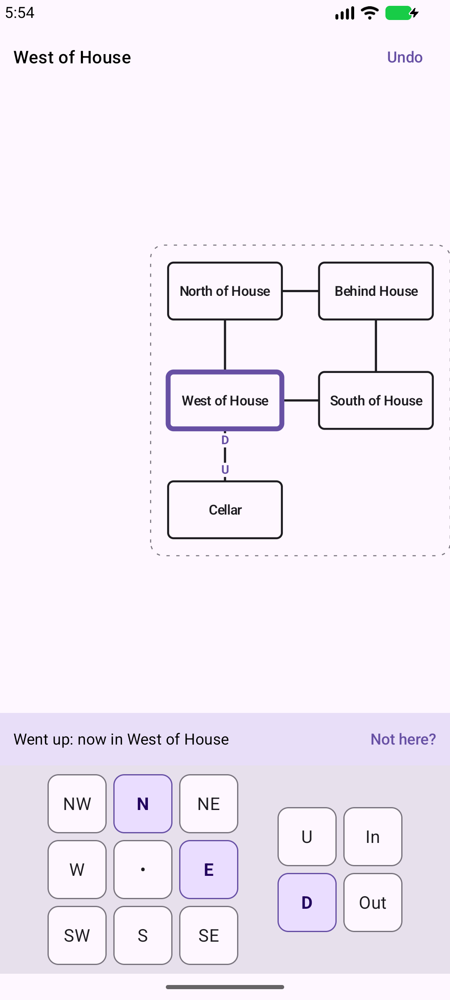
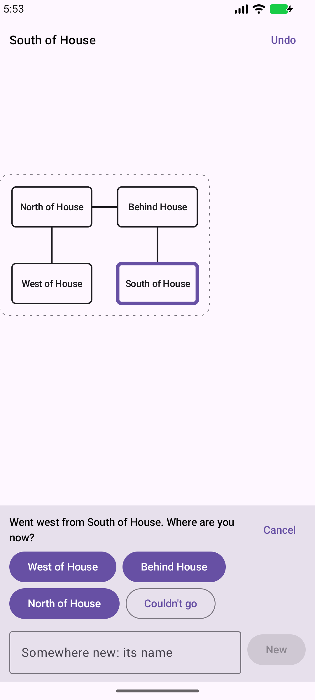
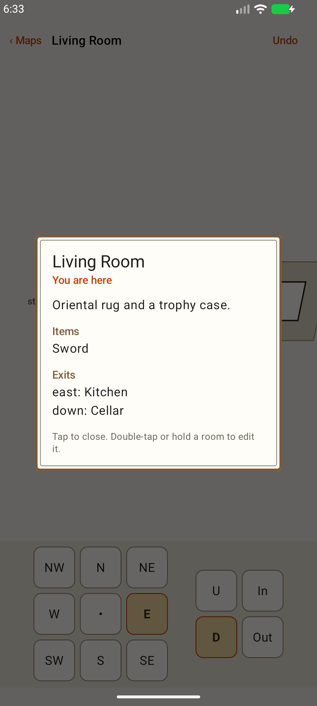
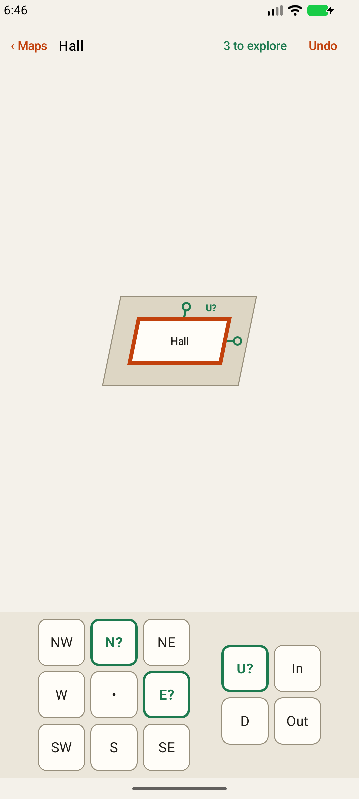
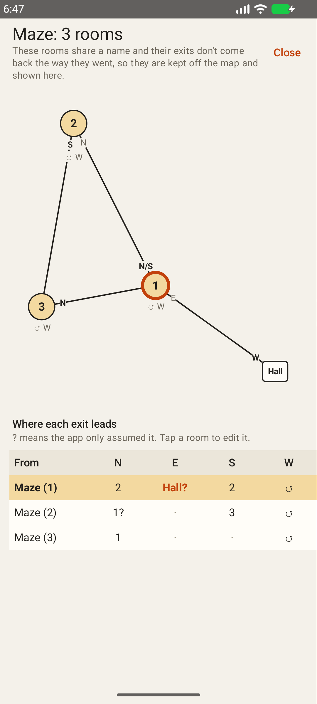
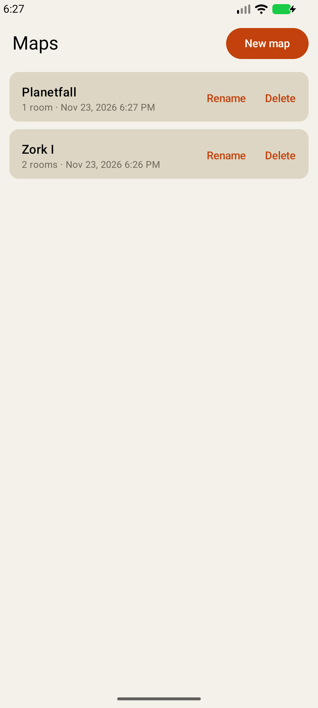

# Droid Mapper Redux

A mapping companion for interactive fiction (Infocom-style text adventures). You tell it
which way you went and what the room is called; it draws the map. You never position a room.

- **One tap per move.** A direction pad is always on screen.
- **It asks after you move.** If the map doesn't know where a direction leads, it asks where
  you arrived, offering its best guesses first so closing a loop is one more tap.
- **Floors are stacked.** Rooms you can walk between share a plate; going up or down leads
  to another plate drawn above or below, in the slanted style of Infocom's printed maps.
- **Passages are assumed two-way** until you say otherwise ("Couldn't go", or the one-way
  switch on a room's card).
- **Tap a room** to see what you know about it in a frame over the map; tap again to put
  it away. Items are also written beside the room on the map.
- **Double-tap or hold a room** for its card: name, description, items, and every way to put
  right something that only became clear later: mark an exit one-way, say it leads
  elsewhere, remove it, merge the room with another ("Same room as…"), or delete it.
- **Unexplored exits.** Hold a direction on the pad (or tick it on the room's card) to note a
  way out the game mentions that you haven't tried. It shows as a green stub on the map and
  in the "to explore" list, and clears itself when you try it.
- **Tangles fold themselves.** Three or more connected rooms with the same name whose exits
  don't come back the way they went (a maze, for instance) become one box on the map. Tap
  the box for a web of the rooms and a table of where every exit leads.
- **One map per game.** The list of maps is where you make, rename and delete them; the app
  reopens on the map you were last in.

| Map and direction pad | Arrival panel | Room view | Room card |
|---|---|---|---|
|  |  |  |  |

| Unexplored exits | A folded tangle | Maps |
|---|---|---|
|  |  |  |

## Install on a phone

Download the `.apk` from the latest [release](../../releases/latest) and open it. Android
will ask you to allow installs from your browser the first time.

## Build

```bash
./gradlew assembleDebug        # app/build/outputs/apk/debug/app-debug.apk
./gradlew testDebugUnitTest
```

## Layout

- `app/` – the Android app (Kotlin, Jetpack Compose). `model/` is pure Kotlin: the map as a
  list of facts, the layout engine, and the arrival guesses.
- `research/` – the Python prototypes the layout was worked out in, with game maps
  extracted from published Infocom sources for testing.
