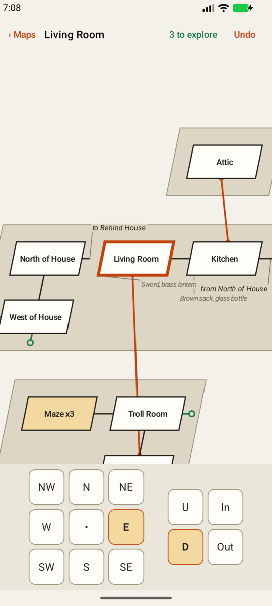
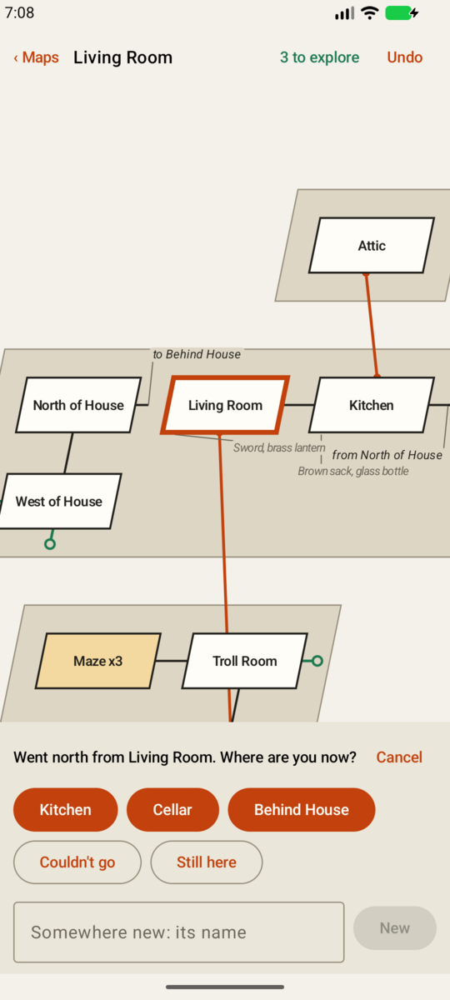
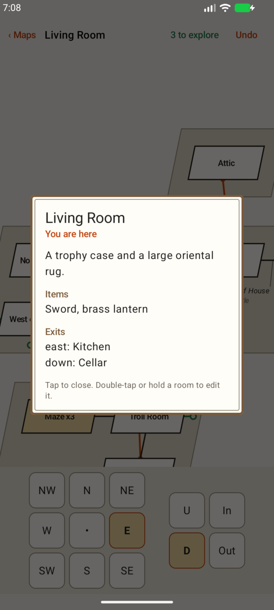
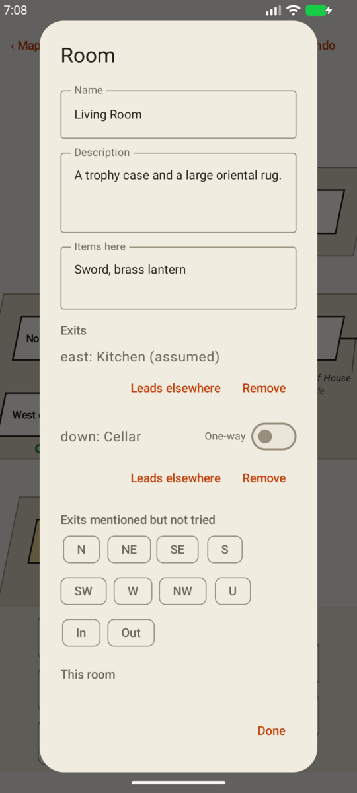
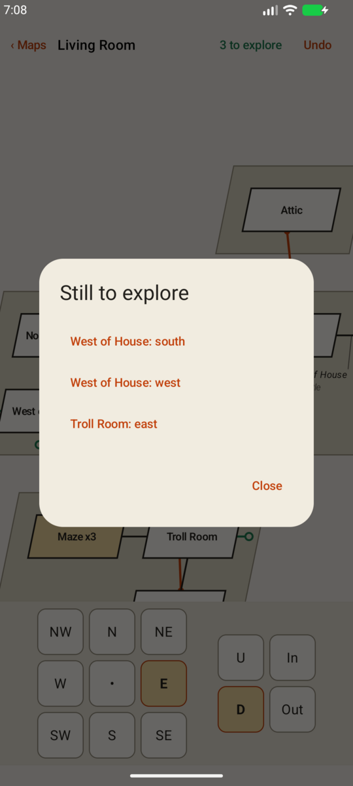
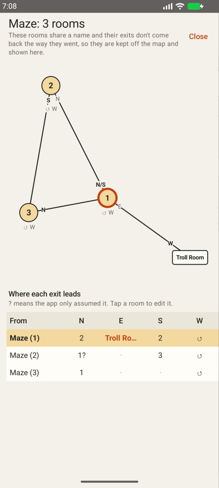
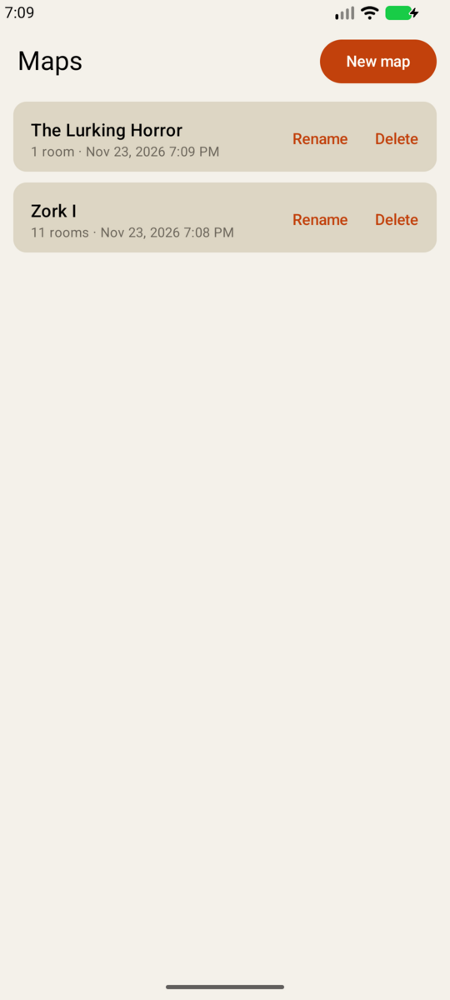

# Droid Mapper Redux

A mapping companion for interactive fiction (Infocom-style text adventures) on Android.

You play the game wherever you play it. In this app you tap the direction you just went and
say where you ended up; the app draws the map. **You never position a room.**

| The map | Arriving somewhere | A room at a glance |
|---|---|---|
|  |  |  |

## Install

Open the latest [release](../../releases/latest) on your phone, download the `.apk` and open
it. Android asks once for permission to install from your browser. New versions install over
the old one and keep your maps.

## How it works

### Moving

- **The direction pad is always on screen**: eight compass points, plus up, down, in and out.
  One tap is one move.
- **If the map already knows where that way leads**, you are moved there and nothing is
  asked. A bar offers "Not here?" in case the game sent you somewhere else.
- **Otherwise the app asks where you arrived**, after the tap, when you actually know:
  - its best guesses for a room you have been in before, as one-tap buttons;
  - a name field for somewhere new (typing also finds existing rooms);
  - "Couldn't go" and "Still here" (an exit that loops back to the same room);
  - or tap the room on the map, which stays visible above the panel.

### The map

- **Stacked floors.** Rooms you can walk between share a plate. Going up or down leads to
  another plate drawn above or below, joined by an orange stair line, in the slanted style of
  Infocom's printed maps.
- **Straight lines only where they are true.** A passage is drawn as a line when the two
  rooms really sit in that direction from each other with nothing in between. Any other
  passage is a short stub with a "to Room" label at each end, so no line ever misleads.
- **Two-way until you say otherwise.** Walking somewhere pencils in the way back. Mark a
  passage one-way on the room's card, or report "Couldn't go" when you try to return.
- **Items** you note for a room are written beside it.
- **The room you are in** has an orange outline, and the map glides to keep it centred.
  Drag to pan and pinch to zoom. Double-tap empty space to see the whole map, and again to
  come back to where you are.

### Rooms

- **Tap a room** to see its name, description, items and exits in a frame. Tap again to
  close it.
- **Double-tap or hold a room** to open its card, where you can edit the name, description
  and items, and put right anything that only became clear later:
  - switch an exit to one-way;
  - say an exit **leads elsewhere**, or **remove** it;
  - **Same room as…** merges two rooms that turned out to be one;
  - **Delete** a room that should never have been made;
  - **I'm here now**, for when you die, restore or get teleported.
- **Undo** steps back through your last hundred changes.

| A room's card | Unexplored exits | A folded tangle |
|---|---|---|
|  |  |  |

### Exits you haven't tried

The app can't read the game, so you tell it which exits were mentioned:

- **Hold a direction on the pad** to mark that way as mentioned but not tried. The key turns
  green with a question mark; hold again to clear it. The same choices are on the room's card.
- On the map each one is a **green stub ending in a ring** (or "U?" / "D?").
- **"3 to explore"** in the top bar lists them all.
- A mark clears itself when you go that way or find you can't.

### Mazes and other tangles

Some clusters of rooms cannot be drawn on a grid in any useful way. The app spots them
without being told, from room names and your moves alone: three or more connected rooms with
the same name whose exits don't come back the way they went.

- On the map the whole cluster becomes **one tinted box**, such as "Maze x3".
- **Tap the box** for the tangle's own view: a web of numbered rooms with the exit to take
  written at each end of every line, and a table of where every exit leads.
- The direction pad keeps working inside a tangle; the top bar shows which room you are in.

### Maps

One map per game. The **Maps** list is where you make, rename and delete them, and the app
reopens on the map you were last in.



## Known limits

- A stairway whose line would have to pass over another room is shown as "up to" and
  "down to" labels at each end. In a large game a fair number of stairways end up that way.
- A stair line can still cross another line or an unrelated plate, though never a room.
- Labels move aside so they never cover a room, a line or each other, with a thin leader back
  to their stub. In a crowded spot that gets busy.
- Folding a tangle redraws the map in one step, so rooms jump once when it happens.
- A tangle that leaves by the same direction to several places only lets the first steer the
  layout; the others are shown as labels.
- The app does not detect one-way passages or duplicate rooms by itself. It gives you quick
  ways to say so.
- Maps live in the app's private storage. Uninstalling the app deletes them, and there is no
  export yet.
- Builds are debug-signed on one machine. A build from another machine will not install over
  an existing one.

## Building

Kotlin and Jetpack Compose, minSdk 24.

```bash
./gradlew assembleDebug        # app/build/outputs/apk/debug/app-debug.apk
./gradlew testDebugUnitTest    # 35 tests on the plain JVM
```

## Repository layout

- `app/src/main/java/com/jrod/droidmapper/`
  - `model/` is pure Kotlin with no Android imports: the map as a list of facts
    (`MapModel.kt`), the layout engine (`AreaLayout.kt`), stacked floors (`Floors.kt`),
    tangle detection (`Tangles.kt`), the tangle web (`Web.kt`) and arrival guesses
    (`Guess.kt`).
  - `data/` stores each map as one JSON file.
  - `ui/` is the Compose screens: the map and pad, the room card, the tangle view and the
    map list.
- `app/src/test/` holds the unit tests, including full playthroughs of Zork I (302 moves)
  and The Lurking Horror (190 moves) that redraw the map after every move.
- `research/` is the Python prototypes the design was worked out in: game maps extracted
  from the published Infocom sources (Zork I and II, Enchanter, Planetfall, The Lurking
  Horror), layout experiments, and a stage-by-stage legibility test.

## How positions are decided

Nothing about position is stored. The map is a list of facts in the order you learned them
("leaving the Kitchen west leads to the Living Room"), and the drawing is worked out from
those facts every time:

1. A compass move to a new room puts it next to where you came from, opening a row or column
   if that cell is taken.
2. A compass move into a known room that contradicts the drawing slides the small branch
   hanging off one end, if that makes more passages line up.
3. Stretched straight passages are shortened wherever nothing is lost.
4. Up and down start a new plate, placed directly above or below the room it is reached
   from. "Up" means higher by one level or more; stairways are then made as short as they
   will go.
