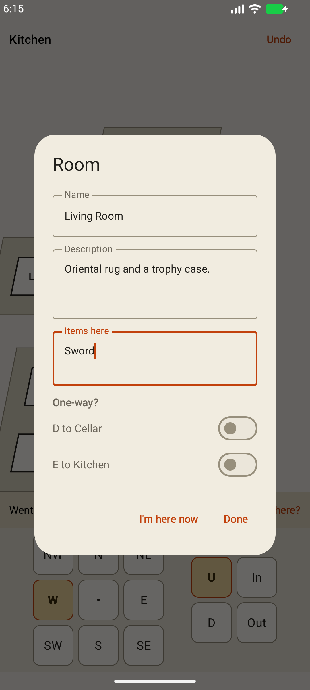

# Droid Mapper Redux

A mapping companion for interactive fiction (Infocom-style text adventures). You tell it
which way you went and what the room is called; it draws the map. You never position a room.

- **One tap per move.** A direction pad is always on screen.
- **It asks after you move.** If the map doesn't know where a direction leads, it asks where
  you arrived, offering its best guesses first so closing a loop is one more tap.
- **Floors are stacked.** Rooms you can walk between share a plate; going up or down leads
  to another plate drawn above or below, in the slanted style of Infocom's printed maps.
- **Passages are assumed two-way** until you say otherwise ("Couldn't go", or the one-way
  switch on a room's card).
- **Double-tap a room** for its card: name, description and the items lying there. Items
  are also written beside the room on the map.

| Map and direction pad | Arrival panel | Room card |
|---|---|---|
|  |  |  |

## Install on a phone

Download the `.apk` from the latest [release](../../releases/latest) and open it. Android
will ask you to allow installs from your browser the first time.

## Build

```bash
./gradlew assembleDebug        # app/build/outputs/apk/debug/app-debug.apk
./gradlew testDebugUnitTest
```

## Layout

- `app/` – the Android app (Kotlin, Jetpack Compose). `model/` is pure Kotlin: the map as a
  list of facts, the layout engine, and the arrival guesses.
- `research/` – the Python prototypes the layout was worked out in, with game maps
  extracted from published Infocom sources for testing.
